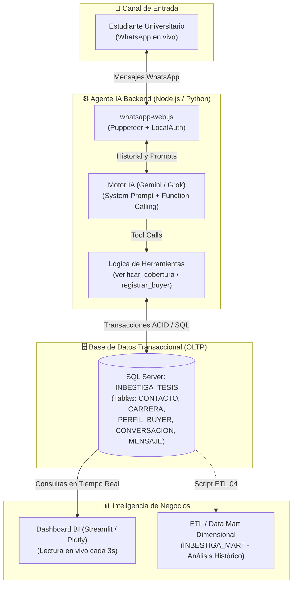
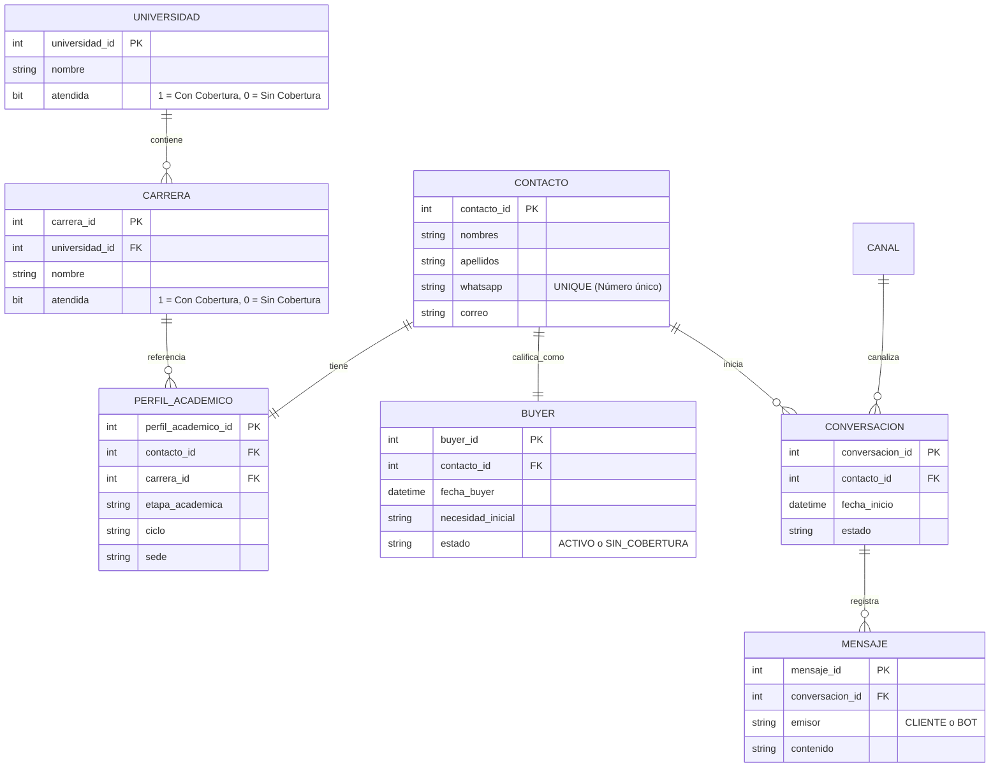

# INBESTIGA - Sistema Agente IA de Captación (Fase BUYER) & Dashboard BI
### Universidad Nacional de Trujillo · Escuela de Ingeniería de Sistemas
**Curso:** Inteligencia de Negocios · **Ciclo:** VIII · **Caso de Negocio:** INBESTIGA (Asesoría de Tesis Universitaria)

---

## 📌 1. Contexto del Proyecto y Problemática de Negocio

### ¿Qué es INBESTIGA?
**INBESTIGA** es una startup y centro especializado en consultoría, asesoría metodológica y estadística para el desarrollo de proyectos de tesis y artículos científicos en el Perú. 

### El Problema de Negocio (Top of Funnel - ToFu)
En el modelo comercial tradicional de asesoría académica, el primer punto de contacto de los estudiantes universitarios es **WhatsApp**. Anteriormente, los asesores de admisiones humanos debían:
1. Responder saludos de forma manual.
2. Preguntar repetitivamente datos básicos: nombre, universidad, carrera y etapa de la tesis.
3. Consultar manualmente tablas o documentos internos de cobertura para saber si la empresa contaba con especialistas activos para esa universidad y carrera específica.
4. Esta fricción causaba **tiempos de respuesta de 15 a 45 minutos**, pérdida de prospectos en horas no laborales (noches y fines de semana) y un desgaste operativo que restaba tiempo a la negociación comercial real.

### La Solución Implementada: Agente IA "Vicky"
Se diseñó e implementó un **Agente Inteligente de Admisión en WhatsApp ("Vicky")** conectado directamente al motor de base de datos relacional de la empresa y a un **Dashboard de Inteligencia de Negocios en Tiempo Real**.
* **Atención 24/7 con latencia < 3 segundos.**
* **Comprensión de Lenguaje Natural (NLU):** Entiende siglas peruanas (`UNT`, `UPAO`, `UCV`, `UPN`, `UNI`, `UNMSM`, `PUCP`), apodos y texto informal.
* **Calificación Automatizada de Cobertura:** Ejecuta *Function Calling* contra SQL Server para verificar si la universidad y carrera están catalogadas como `atendida = 1`.
* **Registro Transaccional Seguro:** Registra de inmediato al estudiante como **BUYER ACTIVO** (con cobertura) o en **LISTA DE ESPERA / SIN COBERTURA** (para detección de demanda insatisfecha - KPI B06).
* **Trazabilidad Inmediata en Dashboard BI:** Cada mensaje y registro impacta al instante en un panel analítico en Streamlit con auto-refresco.

---

## 🏗️ 2. Arquitectura del Sistema de Extremo a Extremo

El sistema funciona mediante una arquitectura desacoplada y orientada a eventos:



### Componentes del Stack Tecnológico:
1. **WhatsApp Gateway:** `whatsapp-web.js` con emulación de navegador Chromium headless y persistencia de sesión cifrada (`LocalAuth`).
2. **Cerebro Cognitivo (LLM):** Google Gemini (`gemini-2.5-flash`) / xAI Grok con soporte nativo de *Tools / Function Calling*.
3. **Capa Transaccional (OLTP):** Microsoft SQL Server (`INBESTIGA_TESIS`), operando bajo transacciones atómicas seguras (`BEGIN TRANSACTION`, `COMMIT`, `ROLLBACK`).
4. **Capa de Inteligencia de Negocios:** Streamlit + Plotly + Pandas con auto-recarga reactiva y visualización de KPIs comerciales.

---

## 🗄️ 3. Las Dos Bases de Datos del Proyecto: ¿Cuál hace qué?

En la arquitectura de Inteligencia de Negocios existen dos bases de datos claramente diferenciadas:

```
┌────────────────────────────────────────────────────────┐      ┌────────────────────────────────────────────────────────┐
│     1. BASE DE DATOS TRANSACCIONAL (OLTP)              │      │     2. DATA MART DIMENSIONAL (OLAP)                    │
│     Nombre: INBESTIGA_TESIS                            │      │     Nombre: DATAMART_INBESTIGA                         │
├────────────────────────────────────────────────────────┤      ├────────────────────────────────────────────────────────┤
│ • Modelo Relacional Normalizado (3FN).                 │      │ • Esquema Estrella / Copo de Nieve (Kimball).          │
│ • Optimizado para escrituras rápidas (INSERT/UPDATE).  │ ETL  │ • Optimizado para consultas analíticas pesadas.        │
│ • Es la fuente viva de operaciones del negocio.        │─────►│ • 18 Dimensiones y 13 Tablas de Hechos.                │
│ • El Bot de WhatsApp escribe aquí en vivo.             │ (04) │ • Alimentado periódicamente por el script ETL.         │
│ • El Dashboard en vivo consulta aquí para latencia 0.  │      │ • Usado para tendencias históricas y minería.          │
└────────────────────────────────────────────────────────┘      └────────────────────────────────────────────────────────┘
```

> **Nota para la Sustentación:**  
> El Agente IA y el Dashboard de Trazabilidad en vivo se conectan directamente a **`INBESTIGA_TESIS` (OLTP)** para garantizar que cuando el jurado envíe un WhatsApp, el registro aparezca reflejado en el panel en menos de 3 segundos sin tener que esperar a que corra un lote ETL nocturno.

---

## 📋 4. Tablas Utilizadas por el Bot y Flujo de Datos

El flujo del bot interactúa con **7 tablas clave** del modelo relacional:



### Flujo de inserción por pasos:
1. **Paso 1 (Lectura de Cobertura):** Al recibir universidad y carrera, la herramienta `verificar_cobertura` ejecuta un `SELECT` sobre `UNIVERSIDAD` y `CARRERA` verificando si `u.atendida = 1 AND c.atendida = 1`.
2. **Paso 2 (Transacción Atómica `registrar_buyer`):**
   - **`CONTACTO`:** Inserta al prospecto con su nombre, apellidos y número de WhatsApp (o actualiza si ya existía).
   - **`PERFIL_ACADEMICO`:** Asocia el contacto con la carrera identificada.
   - **`BUYER`:** Registra el prospecto asignándole el estado `ACTIVO` (si tiene cobertura) o `SIN_COBERTURA` (si va a lista de espera).
   - **`CONVERSACION` & `MENSAJE`:** Registra la sesión y almacena el intercambio exacto de mensajes para fines de auditoría.

---

## 🔌 5. ¿Cómo se conecta el Bot a SQL Server?

* **Tecnología en Node.js (`bot.js`):** Driver nativo `mssql` con el motor C++ `msnodesqlv8`.
* **Modo de Autenticación:** **Windows Authentication (Trusted Connection)**.
  ```
  Driver={ODBC Driver 17 for SQL Server};Server=localhost;Database=INBESTIGA_TESIS;Trusted_Connection=yes;TrustServerCertificate=yes;
  ```
* **Ventajas de esta conexión:**
  1. No expone contraseñas en texto plano dentro del código.
  2. Utiliza conexión por socket nativo de alto rendimiento.
  3. Ejecuta sentencias preparadas con parámetros tipados (`sql.VarChar`, `sql.Int`), haciendo al sistema **100% inmune a inyección SQL**.

---

## 📊 6. Dashboard de Inteligencia de Negocios (KPIs Mostrados)

El Dashboard en Streamlit (`dashboard.py`) consume las vistas y tablas del OLTP calculando en tiempo real:

| KPI | Nombre del Indicador | Fórmula / Lógica | Impacto en el Negocio |
| :---: | :--- | :--- | :--- |
| **B01** | **Tasa de Conversión a Buyer** | $\frac{\text{Total Buyers Registrados}}{\text{Total Contactos en WhatsApp}} \times 100$ | Mide la efectividad del canal WhatsApp para captar prospectos identificados. |
| **B02** | **Tasa de Cobertura Activa** | $\frac{\text{Buyers con Cobertura (ACTIVOS)}}{\text{Total Buyers}} \times 100$ | Indica qué porcentaje de la demanda recibida puede ser atendida por la oferta actual. |
| **B06** | **Demanda Fuera de Cobertura** | $\sum \text{Buyers con estado 'SIN\_COBERTURA'}$ | **KPI Clave de Expansión:** Muestra qué universidades y carreras tienen alta demanda pero no tienen asesores asignados. |
| **B07** | **Resolución Sin Humano (Bot)** | $\frac{\text{Conversaciones cerradas por el Bot}}{\text{Total Conversaciones}} \times 100$ | Cuantifica el ahorro de horas/hombre del equipo humano de admisiones. |

---

## 🎬 7. Guía de Ejecución Rápida y Casos de Prueba en Vivo

### Paso 1: Levantar el Bot de WhatsApp (Terminal 1)
```powershell
cd "c:\Trabajos UNT\CICLO VIII\INTELIGENCIA DE NEGOCIOS\Sistema_AgenteBuyers"
npm start
```
*Inicia mostrando:* `🤖 "VICKY" LISTA Y CONECTADA A WHATSAPP EN VIVO`.

### Paso 2: Levantar el Dashboard BI (Terminal 2)
```powershell
cd "c:\Trabajos UNT\CICLO VIII\INTELIGENCIA DE NEGOCIOS\Sistema_AgenteBuyers"
streamlit run dashboard.py
```
*Abre automáticamente en el navegador:* `http://localhost:8501`.

### Casos de Demostración:
* **Caso 1 (Con Cobertura - ACTIVO):** *"Hola, soy Carlos Mendoza de la UNT de Ingenieria de Sistemas y busco asesoría para mi tesis"* $\rightarrow$ Vicky confirma con la plantilla festiva 🎉, registra en SQL Server y aparece badge verde en el Dashboard.
* **Caso 2 (Sin Cobertura - Lista de Espera):** *"Buenas tardes, soy Andrea Castro de la Universidad de Lima, estudio Diseño Gráfico y busco asesoría"* $\rightarrow$ Vicky informa con la plantilla cordial 🙏 que quedó en lista de espera (alimenta KPI B06).
* **Caso 3 (Mensaje Fuera de Tema / Off-Topic):** *"Hola Vicky, ¿vendes hamburguesas o pizzas?"* $\rightarrow$ Vicky no ejecuta herramientas y redirige con calidez a la asesoría de tesis 🎓.

---

## 👥 9. Estructura de Archivos del Repositorio

```
Sistema_AgenteBuyers/
├── scripts/                                       # Scripts SQL oficiales de la solución
│   ├── 01_CREAR_BD_TRANSACCIONAL_DEFINITIVO.sql  # Creación del modelo OLTP (26 tablas)
│   ├── 02_POBLAR_BD_TRANSACCIONAL_DEFINITIVO.sql # Datos semilla de prueba
│   ├── 03_CREAR_DATAMART_DEFINITIVO.sql          # Creación del Data Mart dimensional (18D + 13F)
│   └── 04_ETL_POBLAR_DATAMART_DEFINITIVO.sql     # Procedimientos de carga analítica
├── bot.js                                        # Agente WhatsApp en vivo (Node.js + Grok/Gemini)
├── dashboard.py                                  # Panel de Inteligencia de Negocios (Streamlit)
├── simulador_chat.py                             # Simulador de chat en Python para pruebas rápidas
├── simulador_chat.js                             # Simulador de chat en Node.js
├── diagnostico_sistema.py                        # Script de validación de salud del sistema
├── .env                                          # Configuración de base de datos y API Keys
├── package.json                                  # Dependencias Node.js (whatsapp-web.js, mssql, etc.)
├── requirements.txt                              # Dependencias Python (streamlit, pandas, plotly, pyodbc)
└── README.md                                     # Este documento maestro de sustanciación
```
